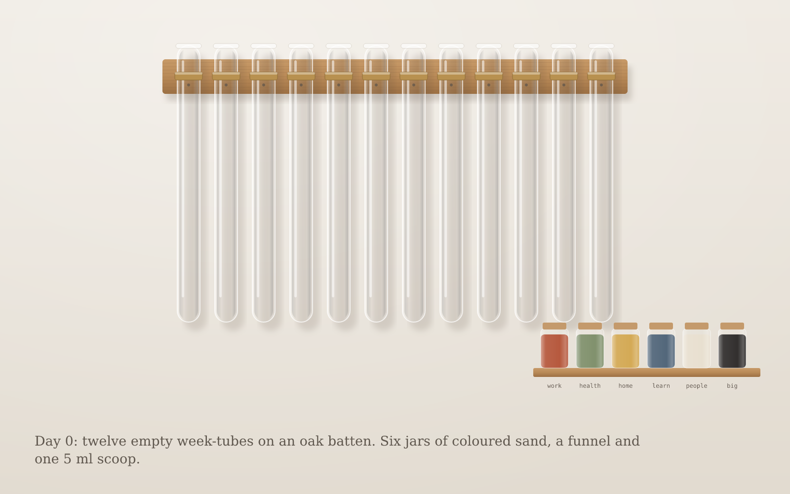
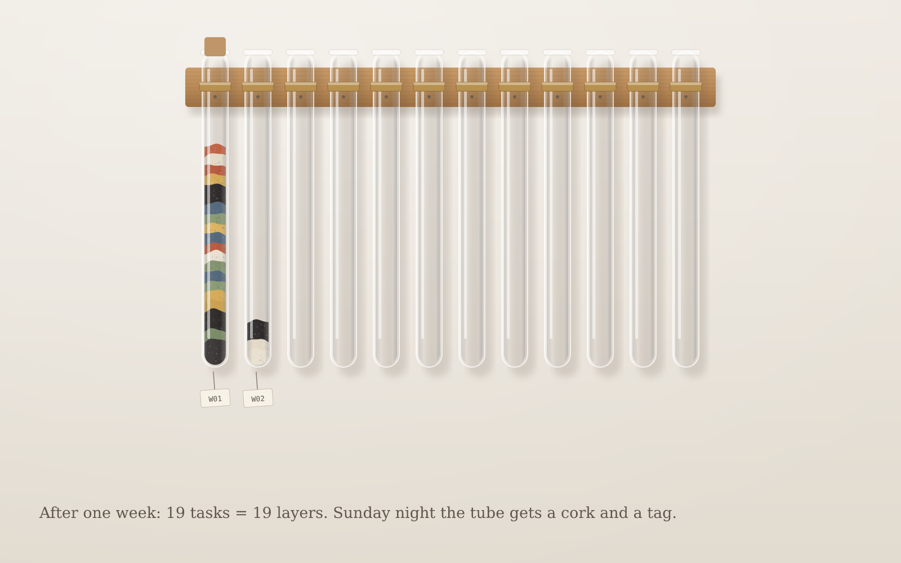
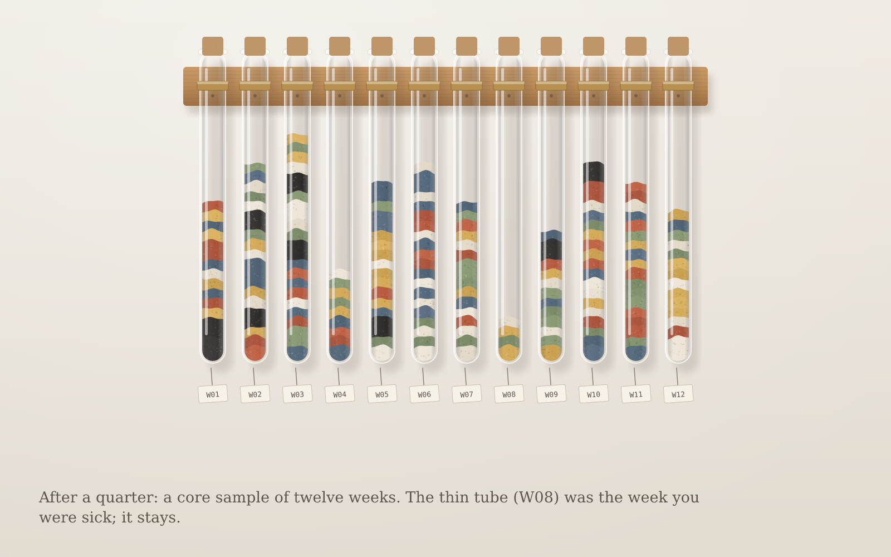
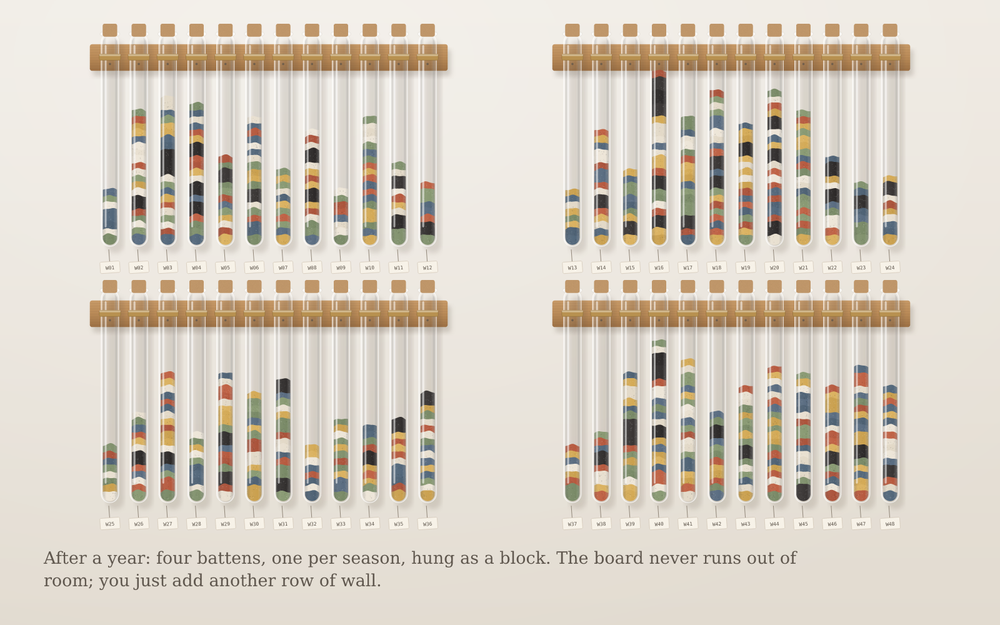

# Core Samples

A progress board you fill by hand: **one glass tube per week, one spoonful of coloured sand per finished task.**
Over months the wall turns into a row of geological core samples. Each tube is a week, and each band is one thing you finished, in order.

| | |
|---|---|
|  |  |
|  |  |

- Tubes: borosilicate, 30 x 300 mm, about 150 ml, which is 30 scoops of 5 ml
- Colour key: terracotta work, sage health, ochre home, slate learning, bone people, charcoal milestone (double scoop)
- 12 tubes on a 1 m oak batten = one quarter; four battens = one year

Renders are generated by `render.mjs` (needs `npm i @resvg/resvg-js`, then `node render.mjs`). Edit the `SAND` palette to preview your own colours.
